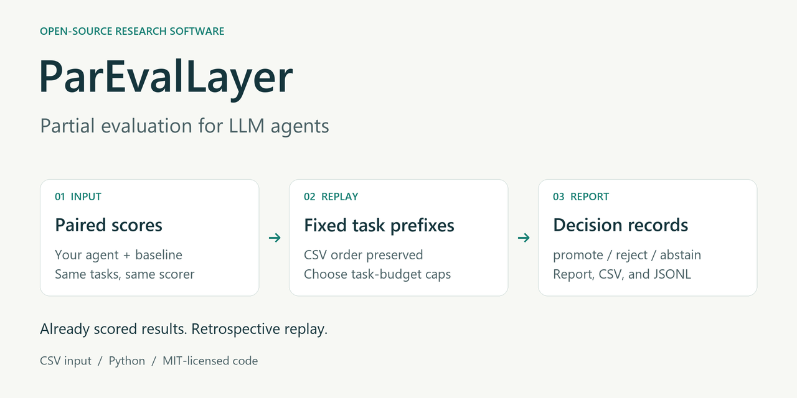

# ParEvalLayer: Compare LLM Agents Using Task Scores

[](https://github.com/WilliamWJHuang/ParEvalLayer-partial-agent-evaluation/actions/workflows/smoke.yml) · [MIT License](LICENSE) · Python 3.12

ParEvalLayer compares two agents using scores you have already collected on the same tasks. Put both scores for each task in a CSV file, choose the minimum improvement you require, and run the comparison. The report shows the average score difference and a result: `promote`, `reject`, or `abstain`.

You can compare all tasks or just the first part of the file. Your existing evaluation tool still runs the agents and scores their work; ParEvalLayer reads those scores.

[Quick start](#quick-start) · [Walk through an example](docs/TUTORIAL.md) · [Use your own results](docs/USING_YOUR_RESULTS.md) · [How the checks work](docs/METHOD.md)



## Quick start

Clone the repository, or download and extract its ZIP:

```text
git clone https://github.com/WilliamWJHuang/ParEvalLayer-partial-agent-evaluation.git ParEvalLayer
cd ParEvalLayer
```

Use Python 3.12. On Windows PowerShell, create a separate Python environment and install the required packages:

```text
py -3.12 -m venv .venv
.\.venv\Scripts\Activate.ps1
python -m pip install -r requirements.txt
```

On macOS or Linux, use `python3.12 -m venv .venv` followed by `. .venv/bin/activate`, then run the same install command.

Try the example:

```text
python compare.py --input examples/paired_results.csv --tested candidate --comparison baseline --threshold 0.05
```

Open `outputs/comparison/report.md`. The example uses eight tasks with made-up scores, so it needs no downloads or API keys. Its result is:

| Fraction of tasks | Tasks used | Average candidate score minus baseline score | Result |
| ---: | ---: | ---: | --- |
| 1.0 | 8 | 0.17 | `promote` |

These numbers demonstrate how the tool works. They do not describe a real agent's performance. The [step-by-step example](docs/TUTORIAL.md) explains the output and shows how to compare the first half of the file.

## Compare your own agents

Save one row per task, with a score from each agent. Score both agents in the same way, using the same scale. Higher scores must mean better performance.

```csv
task_id,tested_score,comparison_score
task_001,0.8,0.6
task_002,0.7,0.5
task_003,0.9,0.7
```

Then run:

```text
python compare.py --input my_results.csv --tested my-agent --comparison baseline --threshold 0.05 --output-dir outputs/my-comparison
```

`--threshold` sets the minimum improvement you want to assess, in your original score units. The tool does not change the score scale. You can also add a `group` column, such as `web` or `code`, to require enough tasks from each category before making a decision.

The result combines the average score difference with a check of how much that average varies when tasks are sampled again:

| Result | How to read it |
| --- | --- |
| `promote` | The average improvement is above your threshold, and the check supports that result. |
| `reject` | The average improvement is at or below your threshold, and the check supports that result. The agent may still be slightly better than the baseline. |
| `abstain` | The check cannot settle the comparison, or too few tasks from a required group have been included. |

By default, the command uses all rows. Add `--budget-caps 0.5 1.0` to compare the first half and then the full file. Rows stay in file order. Choose the task order, amount of data, and improvement threshold before looking at the scores if you plan to use the result for a decision. Trying several settings and keeping a favorable answer can be misleading; the tool does not correct for this or tell you when it is safe to stop a live evaluation.

See [Use your own results](docs/USING_YOUR_RESULTS.md) for the input format, output files, and common errors. Choose an empty or new output directory for each run to preserve earlier reports.

## Check the installation

```text
python reproduce.py --check
```

This checks the CSV workflow, the event-file reader, and their handling of invalid inputs. Run `python reproduce.py` to try the original JSONL example, which stores one record per line.

The example checks and Terminal-Bench checks passed in a fresh local environment. [Validation notes](docs/VALIDATION.md) list what was tested and what has not been reproduced.

## About the research

This repository accompanies *ParEvalLayer: When Partial LLM-Agent Evaluations Support a Decision* by Wei-Jung Huang and Bonan Shen. It includes the comparison code, tests, benchmark readers, analysis scripts, and examples. The paper and PDF are not included.

The study starts with completed public benchmark results. It uses part of a result file, hides the later scores, and compares its decision with the decision from the full shared record. The findings describe those records and the task orders that were tested. They do not establish that every evaluation can be shortened or that the results will hold for future agents. [METHOD.md](docs/METHOD.md) gives the statistical details and assumptions.

## Included benchmark data

Small OSWorld-Verified and Terminal-Bench tables are included with their source and license notices. AppWorld, SWE-bench experiment records, and tau-bench trajectories must be obtained separately. Their readers and analysis code are included. [DATA.md](docs/DATA.md) explains where the data came from and what may be shared.

To check the packaged files and run the included Terminal-Bench example:

```text
python reproduce.py --verify
python reproduce.py --pipeline terminal
```

The `--pipeline tau` and `--pipeline all` options also need separately acquired tau-bench inputs. The repository alone cannot regenerate every result in the paper. See [REPRODUCING.md](docs/REPRODUCING.md) for the supported commands and additional inputs.

## Where to find things

- `compare.py` reads your CSV and writes a comparison report.
- `reproduce.py` runs examples, tests, file checks, and selected benchmark analyses.
- `scripts/` holds the calculation code, benchmark readers, analysis scripts, and figure code.
- `examples/` contains made-up scores for trying the commands.
- `analysis/public_backtest/` contains the benchmark tables approved for this release.
- `docs/` contains the tutorials, method, data sources, and reproduction instructions.

## Citation

Use [CITATION.cff](CITATION.cff) for the paper title and author details when citing this work.

## Help and contributions

Use [GitHub Issues](https://github.com/WilliamWJHuang/ParEvalLayer-partial-agent-evaluation/issues) for questions, bugs, and requests to read other result formats. For a bug report, include the command, Python version, error message, and a small CSV with made-up scores that shows the problem.

For code changes, describe what should happen and run `python reproduce.py --check`. If a change affects the calculation or decision rules, explain that change explicitly.

## License

Project code and documentation use the [MIT License](LICENSE). Third-party data keep their own terms: the OSWorld dataset declares MIT, and the Terminal-Bench leaderboard dataset declares Apache 2.0. [DATA.md](docs/DATA.md) records the source notices and sharing conditions.
